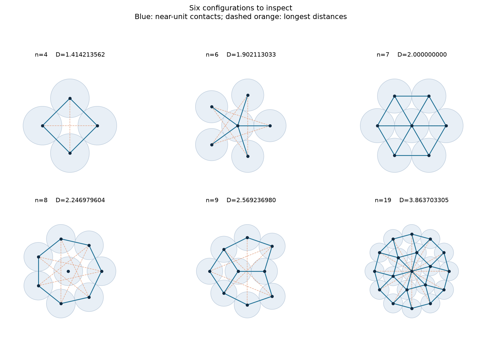

# Erdős #99 computational laboratory

Place `n` points at least one unit apart, then make their **largest pairwise distance** as small as possible. Erdős asks whether every exact optimizer must contain a unit equilateral triangle once `n` is sufficiently large. This laboratory searches for useful examples; it does not certify global optimality.

Start with [the student research report](docs/RESEARCH.md), [the full results table](results/initial/TABLE.md), and [the research log](docs/LOG.md).



## Open the app

Visit **https://aasul.github.io/erdos99-lab/** on a computer or phone. Tap **Open the dot playground**. On a phone, touch a dot and slide your finger. The page adapts automatically to your screen and whether you use touch.

Start with this goal: keep every pair of dots at least 1 unit apart, and try to make the furthest pair closer. Red lines mean dots are too close. Purple triangles have three sides about 1. Open the word guide in the playground for plain explanations.

Saved ideas stay in the browser/device where you saved them. Use **Download a backup file**, then **Open a backup file** on another device to move an idea. This site never chooses moves for you.

## Reproduce the experiment

Tested with Python **3.14.10** on Linux. Exact installed versions, including transitive dependencies, are in `requirements-lock.txt`. Create an environment in this folder:

```bash
python -m venv .venv
.venv/bin/python -m pip install -r requirements-lock.txt
OPENBLAS_NUM_THREADS=1 OMP_NUM_THREADS=1 MKL_NUM_THREADS=1 \
  .venv/bin/python -m unittest discover -s tests -v
OPENBLAS_NUM_THREADS=1 OMP_NUM_THREADS=1 MKL_NUM_THREADS=1 \
  .venv/bin/python -m erdos99.experiment --output results/my_run
.venv/bin/python -m erdos99.analyze results/my_run
```

Alternatively: `bash scripts/reproduce.sh results/my_run`. Choose a fresh output folder: existing trial logs are never overwritten. Dependency downloads need internet access; experiments then run offline. Other Python/platform versions may require compatible dependencies (`pip install .`) and may give different final digits or local minima. Single-thread BLAS and fixed seeds improve reproducibility; they do not guarantee identical floating-point behavior across machines.

## Inspect and extend

```bash
# Short exploratory run (optimization only):
.venv/bin/python -m erdos99.experiment --n-min 12 --n-max 12 \
  --seeds 7 11 19 23 --maxiter 1000 --output results/n12_more

# Add your own n-by-2 JSON array of coordinates:
.venv/bin/python -m erdos99.experiment --n-min 9 --n-max 9 \
  --custom my_points.json --output results/custom9

# Check a saved configuration using Python's standard library alone:
python -m erdos99.verify results/initial/configurations/n08_unrestricted.json \
  --pair-csv /tmp/n08_distances.csv
```

The plotting/report command is designed for the initial full `4..30` run with margins `0.001` and `0.01`. The experiment command supports other ranges, margins and custom starts.

## What is saved

- `erdos99/`: starts, analytic-gradient SLSQP optimization, geometry diagnostics, independent verification, analysis/plotting.
- `results/initial/trials.jsonl`: every baseline and solver trial, including coordinates, seed, solver status and independent checks.
- `configurations/`: the selected unrestricted and margin-constrained examples, in JSON.
- `pairs/`: all pairwise distances for every selected configuration, calculated independently at 60 decimal digits.
- `summary.csv`, `TABLE.md`, `historical_comparison.csv`: comparison tables.
- `figures/`: individual PNG/SVG configurations, a gallery, comparisons and controls.
- `metadata.json`, `audit.json`, `structure.json`: versions, options, verification and numerical symmetry/rigidity diagnostics.

Blue lines join **near-unit** pairs after normalization (tolerance `1e-6`). Dashed orange lines show longest pairs. Numerical contacts are not exact geometric equalities. All numerical search results are upper bounds; known small-case exact results come from the cited mathematics.

## Interactive geometric playground

Open **Erdős 99 Lab** from your desktop, then choose **Open the interactive geometric playground**. The offline playground loads all 81 saved configurations. Drag points or select a point and use arrow keys (Shift moves farther); you can also enter its exact x/y coordinates. The original stays visible as a dashed comparison. Minimum and maximum distances, near-unit triangle counts and pairs below distance 1 update as you move. Red segments mark every numerical distance strictly below 1; triangle/contact tolerance is adjustable and displayed. Nothing is optimized, snapped or rescaled automatically.

Use **Undo move**, **Reset to original**, or **Fit view** as needed. Name your idea, add notes and save it in the current browser. Download a JSON backup for portability; importing a backup restores its original configuration reference, coordinates, notes and tolerance. Changing configurations discards unsaved moves. Browser storage availability varies, especially for local-file pages, so JSON backups are recommended. The Python optimizer and initial results are unaffected.
